<div align="center">

# CV Wala

**A CV that gets you the call.**

A CV builder for job seekers in Pakistan. A short, step-by-step form becomes a well-written CV in 8 professional PDF designs. The CV is checked the way a recruiter checks it, and it comes with a matching cover letter. CV Wala also helps you tailor each CV to a job ad, send the application, practise for the interview and keep track of every job you apply for.

Web app (installable PWA) · iPhone app · Android app. All three are built from one codebase.

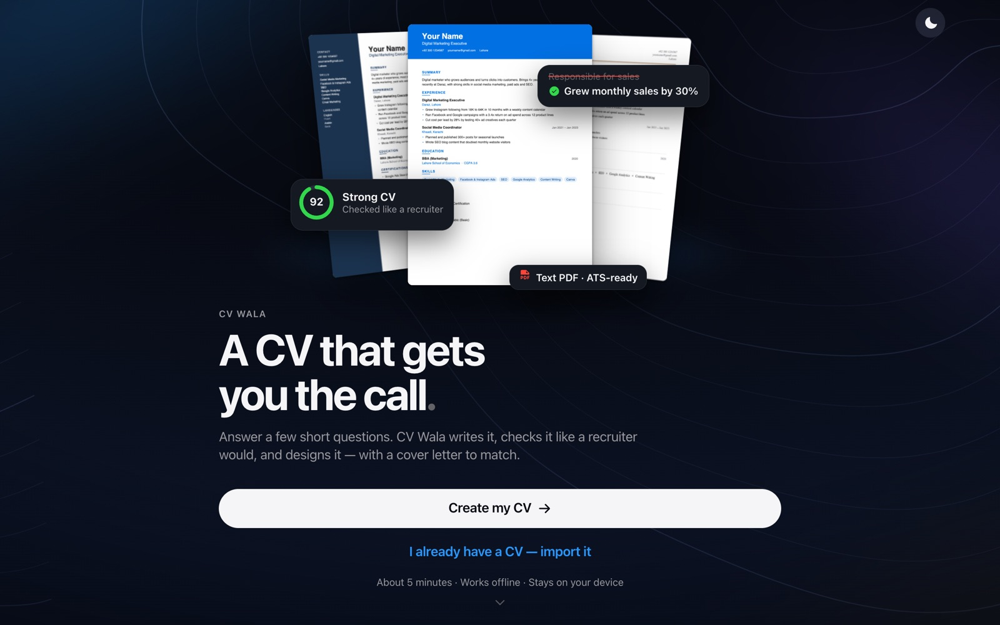

</div>

---

## Contents

- [Why CV Wala](#why-cv-wala)
- [How it works in 60 seconds](#how-it-works-in-60-seconds)
- [Features](#features)
  - [1. Landing page](#1-landing-page)
  - [2. Home and CV score](#2-home-and-cv-score)
  - [3. The editor: a guided form in 5 steps](#3-the-editor-a-guided-form-in-5-steps)
  - [4. Design: 8 PDF templates](#4-design-8-pdf-templates)
  - [5. Job fit check](#5-job-fit-check)
  - [6. Tailor your CV for one job](#6-tailor-your-cv-for-one-job)
  - [7. Cover letter](#7-cover-letter)
  - [8. Send your application](#8-send-your-application)
  - [9. Interview practice and salary help](#9-interview-practice-and-salary-help)
  - [10. Application tracker](#10-application-tracker)
  - [11. Import an old CV](#11-import-an-old-cv)
  - [12. Backup and earlier versions](#12-backup-and-earlier-versions)
  - [13. Optional AI](#13-optional-ai)
- [Privacy](#privacy)
- [Design](#design)
- [Tech stack](#tech-stack)
- [Project structure](#project-structure)
- [Run it locally](#run-it-locally)
- [Build the phone apps](#build-the-phone-apps)
- [Deploy](#deploy)
- [Tests](#tests)
- [Known limits](#known-limits)
- [License](#license)

---

## Why CV Wala

Most job seekers in Pakistan meet the same problems:

| The problem | What CV Wala does |
|---|---|
| Starting from a blank page is hard, especially in English. | You answer short questions. The app suggests skills, example points and the summary for your field. |
| CVs are full of empty lines like "responsible for…" or "hard-working team player". | A built-in coach rewrites weak openings ("Responsible for sales" → "Handled sales"), asks for numbers and flags clichés. |
| People don't know what a recruiter will notice. | Every CV gets a **score out of 100**, with the fixes worth the most points listed first. |
| The same CV is sent to every job. | **One tap makes a version for each job ad**, with the matching skills and points first. |
| Many companies use screening software (ATS) that can't read fancy CVs. | Every design is a **real text PDF**, and the app shows you exactly what the software reads. |
| People forget to follow up, miss deadlines and lose track. | A **tracker** reminds you about deadlines, interviews and follow-ups, with the message ready to send. |
| Mobile data is expensive and connections drop. | **Everything works offline.** AI is an optional extra. |

The copy is written in short, plain English for people who don't speak English as a first language.

---

## How it works in 60 seconds

1. **Pick your field**, for example Sales & Retail, Accounts or Fresh Graduate. This sets suggested skills, example points and wording.
2. **Fill 5 short steps:** contact details, experience, education, then skills and summary. Or **import your old CV** from a PDF or pasted text.
3. **Watch the score.** The Home screen lists the next fixes, each with the points it is worth.
4. **Pick a design** from 8 templates and download a one-page PDF.
5. **Paste a job ad.** You get a job fit check, a tailored CV version, a cover letter, a ready email and WhatsApp message, and interview practice.
6. **Track it** in the Jobs tab until you get the offer.

---

## Features

### 1. Landing page

<table>
<tr>
<td width="33%">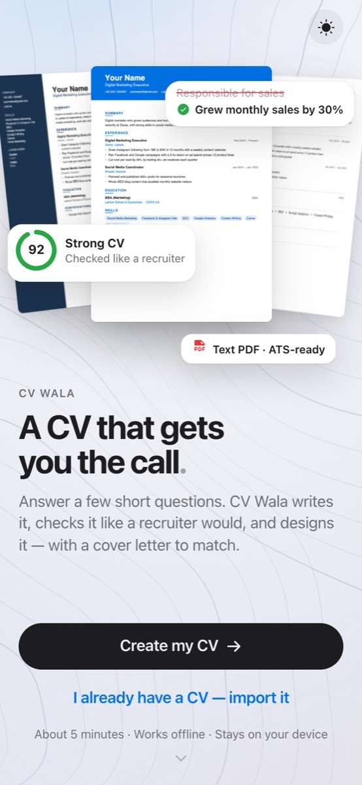</td>
<td width="33%">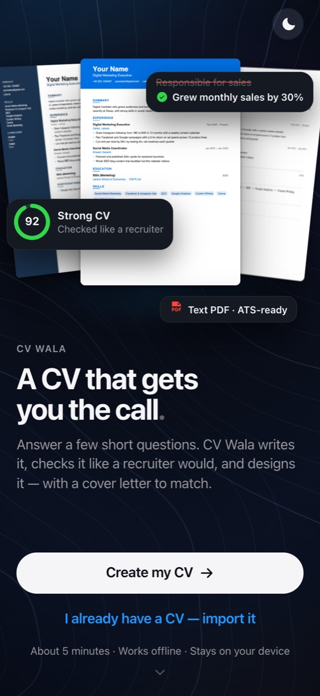</td>
<td width="33%">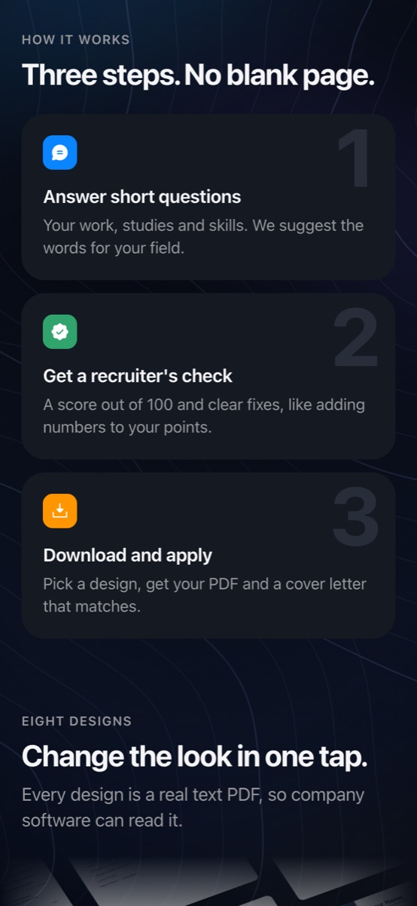</td>
</tr>
<tr>
<td align="center">Light mode</td>
<td align="center">Dark mode</td>
<td align="center">How it works</td>
</tr>
</table>

- **The 3D hero tells the story of the app:**
  - Three real CV pages fan out.
  - A scan line moves down the front page.
  - Cards flip into place: a **92 score**, a **before → after** fix of a weak point, and **"Text PDF · ATS-ready"**.
  - On a computer, the cards move with the mouse at different depths.
- **Below the fold:**
  - "How it works" in three steps.
  - A slowly moving wall of all 8 designs.
  - A final call to action.
- **"I already have a CV — import it"** opens the import sheet straight away.
- **Going back:** tap **CV Wala** at the top of Home to return here. People who already have a CV see **"Go to my CV"** instead of "Create my CV".

### 2. Home and CV score

<table>
<tr>
<td width="50%">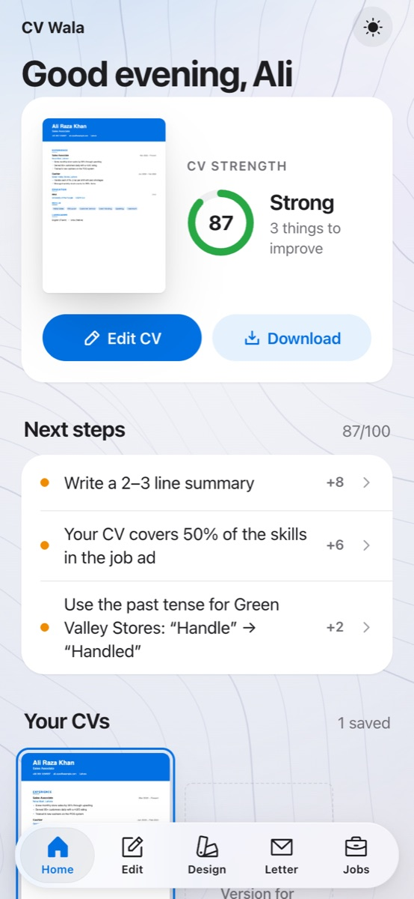</td>
<td width="50%">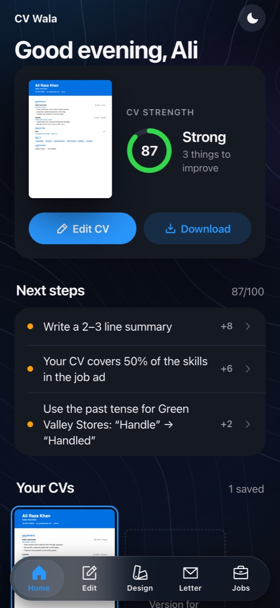</td>
</tr>
</table>

**How the score works** (`src/logic/score.ts`)
- The score is a list of weighted checks, normalised to 100. Examples:
  - full name (6 points)
  - working phone (8)
  - at least one job (14)
  - 2–4 points per job (10)
  - numbers in your points (8)
  - a 2–3 line summary (8)
  - at least 5 skills (7)
- Checks that don't apply are left out of the total instead of counting as zero. For example, skill match only counts once you paste a job ad.
- If any `[example]` text is still in the CV, the score is **capped at 79**, so an unfinished CV can never look "ready to send".
- The **Next steps** list is sorted by points. Tapping a step opens the exact editor step that fixes it.

**Also on Home:**
- **Several CV versions.** For example "Sales" and "Nova Mart" can each have their own target job and letter.
- **Reminders** from the tracker.
- Links to the cover letter, import and backup.

### 3. The editor: a guided form in 5 steps

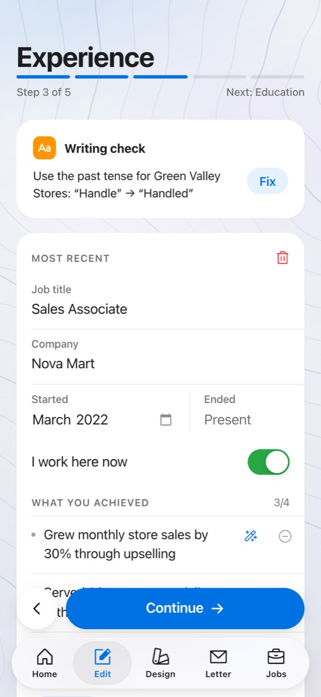

**Field → Contact → Experience → Education → Skills & summary**

**Smart help in each step**
- **Phone and email:**
  - Phone numbers are cleaned to `+92 3XX XXXXXXX`.
  - Common email typos are caught, for example `gmail.con` → `gmail.com`.
  - Names are put in proper capitals.
- **Point coach (magic wand):**
  - Rewrites weak openings: "I was responsible for managing…" → "Managed…".
  - Fixes spelling.
  - Asks for a number when a point has none.
  - Warns when a point is too short or too long.
- **Writing check:**
  - Catches common CV misspellings, such as "managment" and "recieved".
  - Flags clichés recruiters skip, such as "hard-working" and "team player", and suggests what to write instead.
  - Checks tense: past tense for jobs you've left, and one consistent tense for your current job.
  - Most problems have a one-tap **Fix**.
- **Repeated words:** if "Managed" starts 3 or more points, the app offers alternatives like "Oversaw" or "Coordinated".
- **Dates and gaps:**
  - Catches impossible dates and future start dates.
  - Spots **gaps of 6 months or more**, and suggests what could fill them (a course, freelancing, a family business).
  - Total experience is counted with overlapping jobs merged.
- **Summary:** writes itself from your answers and stays up to date until you edit it yourself.
- **Fresh graduate mode:**
  - Applies when you pick "Fresh Graduate", or when every entry is an internship or project.
  - You aren't marked down for having no job. You're asked for a final-year project, an internship, your CGPA or marks, and a course or certificate instead.
  - One-tap buttons add a *Final-year project*, *Internship*, *Volunteer work* or *Freelance work*.

<br clear="right">

### 4. Design: 8 PDF templates

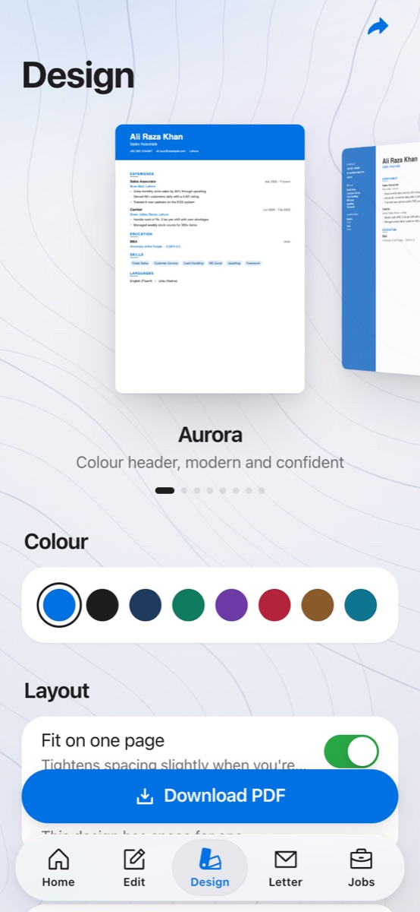

**Aurora, Sidebar, Executive, Minimal, Classic, Bold, Elegant, Compact.** You flip through them in a 3D carousel.

- **8 accent colours,** an optional round photo, and **"Fit on one page"**. The fit option re-renders at slightly tighter spacing, step by step, when you're just over one page.
- **Every preview is the real PDF.** The pages are drawn with pdf.js, so what you see is exactly what you download.
- **Real text PDFs,** not images, so screening software can read them. Letter spacing is limited on purpose: wide letter spacing makes software read headings as "E X P E R I E N C E" and miss the section.
- **"What software reads":**
  - Takes the text out of your actual PDF and checks your name, phone, email, standard section names, job titles and skills.
  - Shows the plain text, so you can see what a company's system sees.
- **Check before download:**
  - Stops embarrassing mistakes such as a missing name, no way to contact you, or leftover `[example]` text.
  - Warns about smaller problems such as bad dates, a very short summary or spelling mistakes.

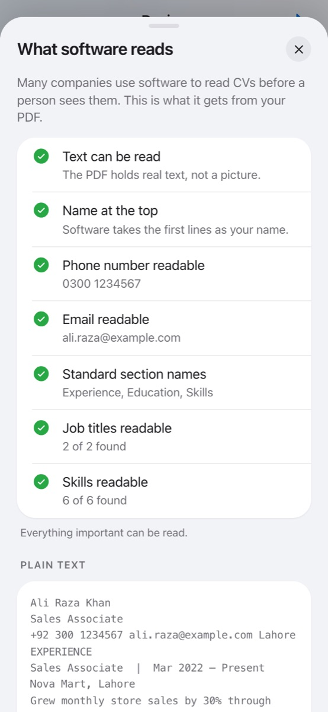

<br clear="right">

### 5. Job fit check

<table>
<tr>
<td width="50%">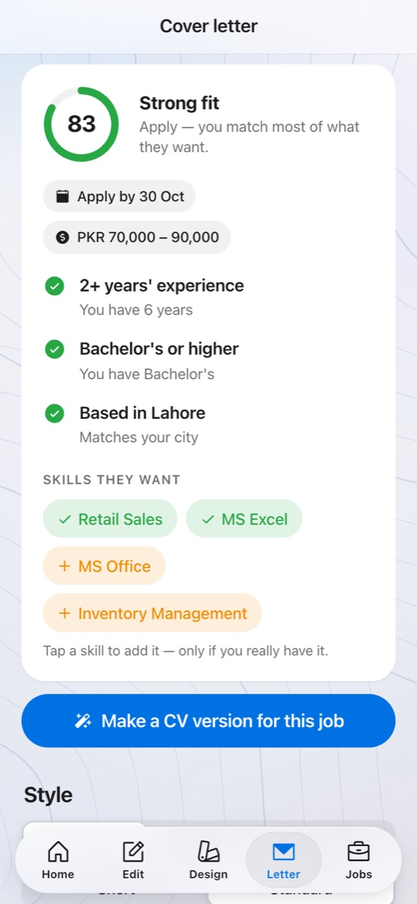</td>
<td width="50%">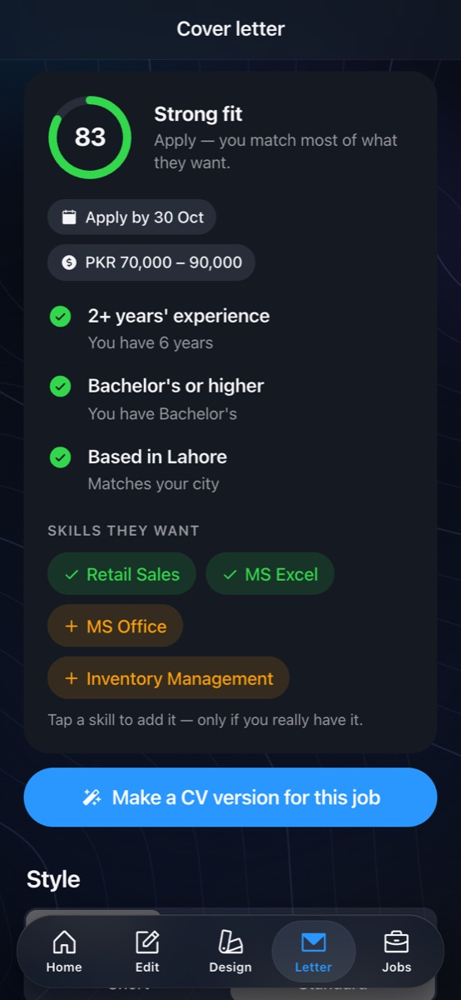</td>
</tr>
</table>

Paste any job ad in the **Letter** tab. `src/logic/jobad.ts` reads it the way an applicant should:

- **Experience required:**
  - Understands wording like "3+ years", "minimum 2 years" or "2–4 years of retail experience", and compares it with your real total.
  - "Fresh graduates welcome" is understood too.
- **Degree level:** matric, intermediate, bachelor's, master's and so on, compared with your highest qualification.
- **City or remote:** if you live elsewhere, the cover letter says you can relocate.
- **Deadline:** read from "Last date: 30 Oct 2026", "Apply by October 20" or "20/10/2026" (Pakistani day/month order).
- **Salary range** and **gender preference**, when the ad states them.
- **Skills:**
  - Which skills the ad asks for that you have, and which are missing.
  - Tap a missing skill to add it, but only if you really have it.
- **Words the ad repeats** that your CV never uses. Words about how to apply, such as "subject line" or "attested copies", are ignored.

**The fit score**
- Skills count most, then experience and degree, then city and the ad's own words.
- Clearly missing a hard requirement **caps the score at 55**, so a strong skills match can't hide that you don't qualify.

### 6. Tailor your CV for one job

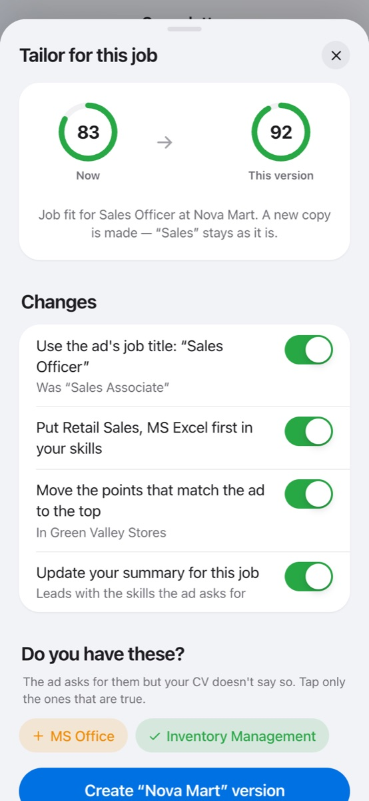

**The most useful feature.** Most people send the same CV to every job, and that is the main reason they don't hear back. Changing a CV by hand for each job takes 20–30 minutes. Here it takes one tap.

Tap **"Make a CV version for this job"**. You'll see your job fit **now** and for **this version**, and a list of changes. Each change can be switched off:

| Change | Rule |
|---|---|
| **Use the ad's job title** under your name | Only when it is in the same line of work, for example "Sales Associate" → "Sales Officer". **It never promotes you.** For a "Manager" job, it keeps your title and tells you why. |
| **Matching skills first** | Skills the ad asks for move to the front. Long lists are trimmed to 10. |
| **Matching points first** | Under each job, the points that use the ad's words move to the top. |
| **Shorten older jobs** | Only on long CVs: older jobs keep their 2 most relevant points. |
| **Update the summary** | Rewritten from the tailored CV. If you wrote your summary yourself, this starts **off**. |

**"Do you have these?"** lists what the ad wants that your CV doesn't mention. Tap only what's true, and watch the fit score rise. **Nothing is added without your tap.**

The result is a **new CV version**. Your original doesn't change, and any application to that company in the tracker now points to the new version.

<br clear="right">

### 7. Cover letter

- **Written from your CV** in one of 3 tones (Formal, Warm, Confident) and 2 lengths.
- **Uses your best evidence:** your points with real numbers. Skills the ad asks for go first.
- **Updates as you type** until you edit it by hand. **Reset** takes you back to the automatic letter.
- **Ways to send it:**
  - download as a PDF
  - copy
  - send on WhatsApp

### 8. Send your application

<table>
<tr>
<td width="50%">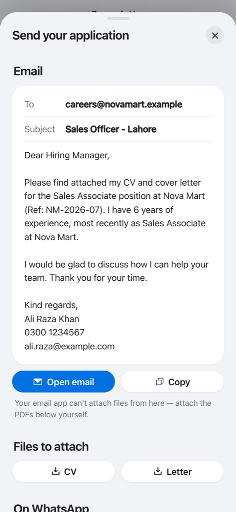</td>
<td width="50%">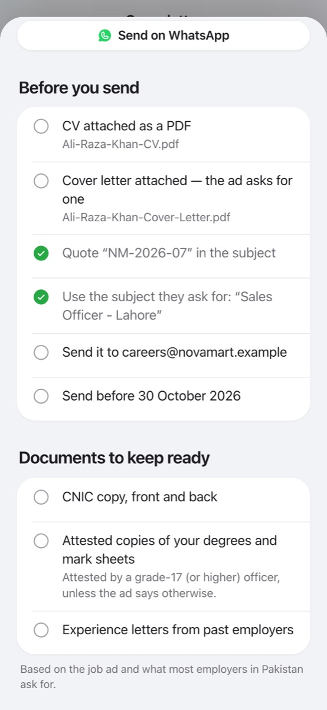</td>
</tr>
</table>

`src/logic/apply.ts` prepares everything needed to actually send the application:

- **A ready email:**
  - The **address** and the **subject line the ad asks for** (for example `Subject line should be: Sales Officer - Lahore`) are taken from the ad.
  - The **reference number** (for example `Ref: NM-2026-07`) is included.
  - A short, polite body with your name and contact details.
  - Opens straight in your email app.
- **A WhatsApp version** for jobs posted on WhatsApp or Facebook.
- **Clean file names:** `Ali-Raza-Khan-CV.pdf` and `Ali-Raza-Khan-Cover-Letter.pdf`. No spaces, so they're safe on every phone and email system.
- **Before you send:** a checklist built from the ad. It covers whether a cover letter was asked for, the reference, the subject, the email address, the deadline, a photo and your expected salary.
- **Documents to keep ready:**
  - Always: CNIC copy and degree copies.
  - Added when the ad mentions them: **attested** or **HEC-attested** degrees, **domicile**, passport-size photos, experience letters, a police character certificate, NOC, IBCC, council registration (PEC, PMDC…), a **bank challan** for the fee, and prep for written tests such as NTS, PPSC or FPSC.

### 9. Interview practice and salary help

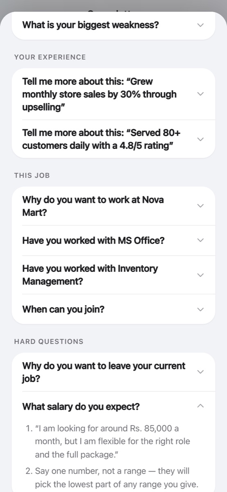

**Interview practice** (`src/logic/interview.ts`)
- Lists the questions you are likely to get for **this job**, grouped into *About you*, *Your experience*, *This job*, *Hard questions* and *Questions to ask them*.
- Each question has an **answer outline built from your own CV.** For example, *"Tell me more about: Grew monthly store sales by 30%"* comes with a situation → action → result → lesson outline.
- **Hard questions appear only when they apply to you:**
  - a gap in your dates
  - less experience than the ad asks for
  - moving to another city
  - why you're leaving your current job
  - skills you're missing
- **Fresh graduates** get questions about their final-year project and "Why should we hire you without experience?".
- Say your answer out loud, then tap to compare.

**Salary help** (`src/logic/salary.ts`)
- **Reads salaries written the Pakistani way:** "60k", "1.2 lac", "Rs. 90,000 – 120,000", "PKR 1.5 lakh per month" or per year.
- **Suggests one number** in the upper part of the ad's range, with a sentence to say in the interview.
- **Warns** when your number is far above the range (they may not call you) or below it (you can ask for more).
- **Never invents market rates.** With no range in the ad, it suggests asking for their budget, and checking similar jobs on Rozee.pk first.

<br clear="right">

### 10. Application tracker

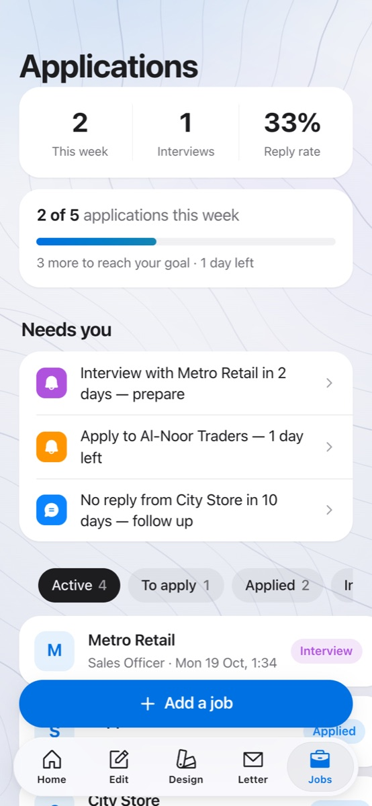

The **Jobs** tab follows every application through *To apply → Applied → Interview → Offer / Closed*.

- **Needs you:** the most urgent things first.
  - an interview within 48 hours
  - a deadline within 3 days
  - no reply after 7 days, with a **ready follow-up message** for WhatsApp or email
  - offers waiting for a reply
- **Weekly goal:**
  - Pick 3, 5, 10 or 15 applications a week.
  - A progress bar, days left, and a **streak** for the weeks in a row you hit the goal.
- **Honest numbers:** applications this week, interviews, and a reply rate that only appears once 3 or more applications are out.
- **Insights from your own results.** For example, *"Your 'Sales' CV gets the most interviews: 3 of 4"* or *"Jobs from Rozee.pk reply most often"*. These only appear once there's enough data to mean something.
- Each application remembers **which CV version you sent**. From an application you can open interview practice for that job.

<br clear="right">

### 11. Import an old CV

**Paste the text of your old CV, or choose the PDF.** `src/logic/importer.ts` reads it and fills the form:

- **Contact details:** name, phone, email, city and LinkedIn.
- **Section headings,** including Pakistani styles like "CAREER OBJECTIVE" and "ACADEMIC QUALIFICATION".
- **Jobs:** date ranges ("Mar 2021 – Present", "2018-2020") and job headers ("Title | Company, City").
- **Education:** degrees, institutes, years and grades (CGPA or %).
- **Skills and languages,** with the level for each language.
- **Your job field,** guessed from your titles and skills.

Before you confirm, a summary shows what was found. A copy of your current CV is saved first, so the import can be undone.

### 12. Backup and earlier versions

- **Backup:**
  - Saves every CV, letter and application to **one file**.
  - Keep it in Google Drive, email or WhatsApp, and **restore it on a new phone or browser**.
  - The file is checked before anything is replaced, and you're asked to confirm.
- **Earlier versions:**
  - A copy of each CV is saved **once a day while you edit**, and **before every import, AI rewrite or restore**.
  - Up to 8 copies are kept per CV.
  - Restoring one also saves the current version first, so you can always go back.

### 13. Optional AI

With an `ANTHROPIC_API_KEY` on the server, two extra buttons appear:
- **"Rewrite with AI"** for job points.
- **"Write with AI"** for the cover letter.

They use Claude (`claude-opus-5-5`) with structured output.
- **The key stays on the server.** The app never sees it.
- **Limits keep the bill small:** each visitor gets 5 AI requests a minute and 40 a day, and there is a ceiling of 300 for everyone together each day. Only the CV Wala app and its own site can use the API; other websites are refused.
- **Without a key, the AI buttons are hidden** and everything else works the same.

---

## Privacy

- **Your CVs stay on your device.** They're saved in the browser or app storage (`localStorage`). There's no account and no CV database.
- **Nothing is sent anywhere** unless you use an AI button. In that case, only the text being rewritten goes to the server.
- **Backups are files you control.**

---

## Design

The look follows iOS "Liquid Glass":

- **Glass only on floating chrome** (tab bar, navigation bar, bottom docks, toasts). Content sits on solid cards, so it's easy to read.
- **Light, Dark and Automatic** themes, switched with a circular reveal. The theme is set before the first paint, so there's no flash.
- **Background:** drifting studio-light beams and generated topographic contour lines that draw in once per session, with a vignette, grain and slight parallax.
- **Motion:** shared spring settings, fast and without wobble, through `motion/react`. Reduced-motion settings are respected.
- **Sharp 3D:** CV pages tilt in 3D but rest flat. Chrome draws 3D layers at low resolution, so a resting page in 3D would make the CV text blurry.
- **Icons:** Phosphor icons. No emoji in the UI.

---

## Tech stack

| Area | Choice |
|---|---|
| App | React 19, TypeScript, Vite 8 |
| Mobile | Capacitor 8 (iOS and Android), with haptics, a native share sheet and file saving |
| PDF | jsPDF (8 templates, text PDFs), pdf.js (previews and text extraction). Both are loaded only when needed. |
| Motion and icons | `motion/react`, `@phosphor-icons/react`, Inter variable font |
| Server | Express 5 (run with `tsx`): serves the app and `/api` |
| AI (optional) | `@anthropic-ai/sdk` with Claude |
| Tests | Vitest: 55 tests of the product logic |

---

## Project structure

```
src/
  logic/        All product rules, as pure tested functions (no React):
    score.ts        CV score, weighted checks, fresher rules
    writing.ts      spelling, clichés, tense
    bullets.ts      point coach and repeated verbs
    format.ts       phone/email cleanup, dates, gaps, years of experience
    summary.ts      automatic summary
    letter.ts       cover letter and skill matching
    jobad.ts        reads a job ad and computes the fit
    tailor.ts       one-tap CV version for a job
    apply.ts        email/WhatsApp text, file names, checklists, documents
    interview.ts    likely questions with answer outlines
    salary.ts       reads salary ranges and suggests an answer
    importer.ts     old CV (text or PDF) to form fields
    ats.ts          checks the text taken out of the PDF
    tracker.ts      reminders, stats, weekly goal, insights
    backup.ts       one-file backup and restore
    history.ts      earlier versions of each CV
    preflight.ts    check before download
    __tests__/      tests for all of the above
  screens/      Welcome, Home, Edit, Design, Letter, Jobs
  components/   sheets (Tailor, Apply, Interview, ATS, Backup, Import), UI kit, background
  lib/          pdf.ts (templates), thumbs.ts (previews), pdftext.ts, native helpers, API client
  data/         job fields, Pakistani cities and degrees, templates, sample CV
  state/        a small store saved to localStorage, navigation, theme
  styles/       app.css (design tokens, light and dark)
server/         Express API and the Claude calls
android/, ios/  Capacitor native projects
docs/           screenshots for this README
```

The rule for contributors: **product rules go in `src/logic/`, not in components.** See [CLAUDE.md](CLAUDE.md) for more conventions.

---

## Run it locally

Requires Node.js 22.12 or newer (`.nvmrc` pins 22). Vitest and the Capacitor CLI don't run on Node 20.

```bash
npm install
cp .env.example .env      # optional: add ANTHROPIC_API_KEY to turn on the AI buttons
npm run dev               # web on http://localhost:5173, API on :8787
```

Other commands:

```bash
npm test          # run the logic tests
npx tsc -p .      # typecheck
npm run build     # production build into dist/
npm start         # production: one server hosts dist/ and /api
```

---

## Build the phone apps

```bash
npm run build && npx cap sync   # copy the web build into ios/ and android/
npm run ios                     # open in Xcode (needs full Xcode on a Mac)
npm run android                 # open in Android Studio
```

- **Android:** Gradle needs **JDK 17–21**. Java 25 and newer break this Gradle version. From the command line:
  ```bash
  cd android && JAVA_HOME=/path/to/jdk-21 ./gradlew assembleDebug
  ```
- **AI in the phone apps:** deploy the server first, then set `VITE_API_URL` to its public URL before building. The web version calls `/api` on the same address.

---

## Deploy

`npm run build && npm start` runs one Node server that serves the web app and the API. Set `ANTHROPIC_API_KEY` (optional) and `PORT` in the environment. Never put the key in a `VITE_` variable, because those are built into the app that users download.

Before you put the key on a public server, check these settings (see `.env.example`):

| Setting | What it does | Default |
|---|---|---|
| `ALLOWED_ORIGINS` | Extra web addresses allowed to call the API, comma-separated. Needed only if the web app is on a different domain from the server. The iOS and Android apps are always allowed. | none |
| `TRUST_PROXY` | Set to `1` on hosts that put a proxy in front of your app (Render, Railway, Fly, Nginx), so each visitor is limited separately. Leave it empty when there is no proxy. | off |
| `AI_PER_MINUTE` | AI requests one visitor can make per minute. | 5 |
| `AI_PER_DAY` | AI requests one visitor can make per day. | 40 |
| `AI_DAILY_BUDGET` | AI requests for everyone together per day (UTC). This caps the worst-case bill. | 300 |

IPv6 visitors are counted per network (/64), so changing address doesn't reset their limit. When a limit is reached the app shows a friendly message, and everything except the AI buttons keeps working.

---

## Tests

```bash
npm test
```

**55 tests in `src/logic/__tests__/` cover:**
- the score
- the writing checks
- fresher rules
- date and gap handling
- the importer, tested with a realistic Pakistani CV
- job ad reading, including deadlines, salaries and the hard-requirement cap
- tailoring, including that it never promotes you and never asks about how-to-apply words
- application text, checklists and documents
- interview questions
- the ATS check
- backup round trips
- version history
- the tracker's reminders, weekly goal and insights

---

## Known limits

- **Import:**
  - Word (.docx) files can't be read directly. Copy the text from Word and paste it.
  - Scanned PDFs, which are photos of paper, have no text to read.
- **Spelling:** the spelling check uses a fixed list of about 80 common CV mistakes. It is not a full dictionary.
- **Reminders** appear inside the app only. There are no push notifications yet.
- **Email attachments:** "Open email" can't attach the PDFs. Download them and attach them yourself.
- **Earlier versions** leave out the photo to save space. Restoring keeps your current photo.
- **iOS builds** need a Mac with full Xcode.

---

## License

[MIT](LICENSE) © 2026 Abdul Haseeb Dar
